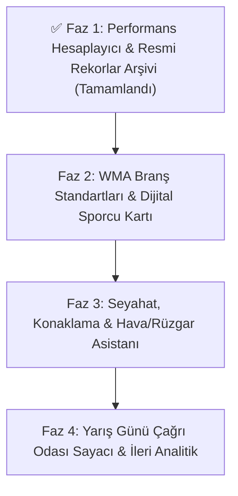

# 🏃 Master Athlete - Uygulamadaki Son Durum ve Geliştirme Yol Haritası (Roadmap)

> **Proje:** Master Athlete (Android / Jetpack Compose)  
> **Mevcut Sürüm:** `1.0.0` (`versionCode = 10`)  
> **Odak Kitle:** Master / Veteran Atletler (35+ Yaş Grupları), Antrenörler ve Atletizm Kulüpleri  
> **Son Güncelleme:** 3 Kasım 2026  

---

## ✅ Uygulamadaki Son Durum (Halihazırda Mevcut Özellikler)

Uygulamada şu ana kadar tamamlanarak aktif kullanıma sunulan tüm modüller ve özellikler aşağıda maddeler halinde özetlenmiştir:

1. **Küresel Yarışma Takvimi & 50 Yıllık Arşiv (1975–2027+):**
   - Otonom AI tarama motoru ve çoklu kaynak toplayıcısı ile güncellenen Ulusal, Balkan, Avrupa ve Dünya master atletizm şampiyonaları.
   - Her yarışma kartında ülke bayrağı, yarışma kapsamı, kalan gün sayacı (`CountdownBadge`), tarih ve şehir bilgisi.
2. **Gelişmiş Arama, Tarih ve Çoklu Filtreleme:**
   - Şehir veya şampiyona adına göre anlık arama.
   - Hızlı tarih filtreleri (`Tümü`, `Gelecek 3 Ay`, `Bu Yıl`, `Gelecek Yıl`, `Geçmiş Arşiv`) ve tamamlanan yarışmaları gizleme seçeneği.
   - Kapsam (`Ulusal`, `Balkan`, `Avrupa`, `Dünya`) ve ülke bazlı detaylı alt pencere filtrelemesi.
3. **Yarışma Detayları, Harita & Cihaz Takvimi Entegrasyonu:**
   - Stadyum ve şehir konumunu tek tıkla **Google Haritalar** üzerinde açma.
   - Şampiyonayı tek dokunuşla telefonun **Cihaz Takvimine** kaydetme ve resmi organizasyon web sitesine yönlendirme.
4. **Kapsamlı Resmi Master Rekorları Arşivi (`🏆 Rekorlar` Sayfası):**
   - Ana sayfa üst barından doğrudan erişilen tam ekran **Resmi Master Rekorları** modülü.
   - **Açık Saha (Outdoor)** ve **Salon (Indoor)** ayrımıyla tüm yaş kategorileri (`M35–M100`, `W35–W100`) ve **Karma (`MIX`) Bayrak** kategorileri.
   - **Türkiye Rekorları (NMR - TAF)**, **Balkan Şampiyona Rekorları (BŞR - BAMA)**, **Balkan Rekorları (BMR - BAMA)**, **Avrupa Rekorları (EMR - EMA)** ve **Dünya Rekorları (WMR - WMA)** dahil **3.000+ resmi rekor**.
   - Seçilen yaş kategorisi ve cinsiyete göre **dinamik branş filtreleme** (Örn: M35 için 110m Engelli, W35 için 100m Engelli, W40+/M70+ için 80m Engelli).
   - Ortak rekor (`🤝 Ortak Rekor`), el kronometresi (`⏱️ El Zamanı Tescili`) gösterimi ve sporcunun kendi kişisel en iyi derecesiyle (`Senin En İyi Derecen (PB)`) canlı karşılaştırma kartı.
5. **WMA Yaş Faktörü (Age Grading) & Performans Hesaplayıcısı:**
   - Sporcunun yaşına, cinsiyetine ve branşına göre yaptığı derecenin **20-30 yaş Açık Yaş Elit dengini** ve **Dünya Klasman Yüzdesini** (`%90+ Dünya Klasmanı`, `%80+ Ulusal Klasman`, `%70+ Bölgesel Klasman`) hesaplayan interaktif motor.
   - Hesaplanan dereceyi tek tıkla doğrudan sporcu profiline kaydetme özelliği.
6. **Sporcu Profili, Kariyer Dereceleri (`PB` / `SB`) ve Yarış Takibi:**
   - **Takibimdekiler** ve **Derecelerim** olmak üzere iki sekmeli sadeleştirilmiş profil yapısı.
   - **Koşu**, **Atlama** ve **Atma** branşlarına özel tasarlanmış ikonlarla gruplanan derece kartları.
   - Kategori bazlı **PB (Kişisel En İyi)**, **SB (Sezonun En İyisi)**, **Podyum Madalyaları (`🥇 1.lik`, `🥈 2.lik`, `🥉 3.lük`)**, **Rekor Rozetleri (`NMR`, `BMR`, `EMR`, `WMR`)** ve otomatik **WMA Performans Yüzdesi (`% WMA`)** rozetleri.
   - Branş tipine göre akıllı derece girişi (Sprint için `Saniye.Salise`, Orta/Uzun mesafe için `Dakika:Saniye.Salise`, Maraton için `Saat:Dakika:Saniye`, Saha atlama/atma branşları için `Metre.Santimetre`).
   - Takip edilen yarışların tarihi geçtiğinde tek tıkla o yarışmaya ait derece ekleme akışı.
7. **Yarış Günü & Çağrı Odası (Call Room) Isınma Zamanlayıcısı (`⏱️ Çağrı Odası`):**
   - Ana sayfa üst barında `🏆 Rekorlar` butonunun hemen yanında yer alan yarış günü asistanı.
   - Branş grubuna göre (**Sprint & Engelli**, **Orta & Uzun Mesafe**, **Atlama & Atma**) özelleştirilmiş adım adım ısınma, dril, çivili giyme ve **Çağrı Odası (Call Room)** zaman çizelgesi.
   - Saniye bazlı canlı **Çağrı Odasına Kalan Süre** ve **Starta Kalan Süre** geri sayımı, özelleştirilebilir çağrı odası kapanış süresi (`-15 dk`, `-20 dk`, `-30 dk`, `-40 dk`) ve interaktif yarış günü ekipman kontrol listesi (Checklist).
8. **Koyu / Açık Tema & Çevrimdışı (Offline-First) Mimari:**
   - İnternet bağlantısı olmasa bile tüm yarışma takvimine, 3.000+ rekor arşivine ve kişisel derecelere anında erişim.
   - Sistem varsayılanı, Açık Tema ve Koyu Tema seçenekleri.

---

## 🗺️ Geliştirme Yol Haritası & Fazlar

---

## ✅ FAZ 1: Sporcu Performans & Rekor Modülleri *(TAMAMLANDI)*

- [x] **1. WMA Yaş Faktörü (Age Grading) & Performans Hesaplayıcısı** *(Tamamlandı)*
- [x] **2. Resmi Master Rekorları Arşivi (NMR, BŞR, BMR, EMR, WMR - Açık Saha & Salon)** *(Tamamlandı)*
- [x] **3. Yaş ve Cinsiyete Göre Dinamik Branş & Engel/Atma Uyumluluğu** *(Tamamlandı)*

---

## 🎯 FAZ 2: WMA Standartlar Rehberi & Dijital Sporcu Kimliği *(SIRADAKİ FAZ)*

### 1. 📏 WMA Engel & Atma Ağırlıkları Standart Tablosu (Teknik Kural Rehberi) *(Yeni Fikir)*
- **Amaç:** Master atletlerin yaş grubu değiştikçe en çok ihtiyaç duyduğu teknik ekipman ve engel ölçülerini tek ekranda sunmak (Ana sayfada `Rekorlar` butonunun yanına çok yakışacak kardeş modül).
- **Kapsam:**
  - **Atma Ağırlıkları:** Yaş ve cinsiyete göre Gülle (`7.26kg -> 3kg`), Disk (`2kg -> 0.75kg`), Cirit (`800g -> 400g`), Çekiç ve Ağırlık Atma ekipman ağırlıkları.
  - **Engelli Koşu Ölçüleri:** Kısa engelli (`110m / 100m / 80m` ve Salon `60m`) ile uzun engelli (`400m / 300m / 200m`) branşlarında **engel yüksekliği (cm)**, **ilk engele mesafe (m)**, **engeller arası mesafe (m)** ve **son engelden varışa mesafe (m)** tablosu.
  - **Su Engelli (Steeplechase):** Yaş grubuna göre `3000m` / `2000m` engel yüksekliği (`0.914m` vs `0.762m`).

### 2. 🎽 Dijital Sporcu Yarışma Kartı (Social Share Badge)
- **Amaç:** Atletlerin yarışma sonuçlarını, PB (Kişisel En İyi) derecelerini ve madalyalarını sosyal medyada (Instagram Story, WhatsApp vb.) profesyonel bir şablonla paylaşabilmesi.
- **Kart Bileşenleri:**
  - Şampiyona adı, ev sahibi ülke bayrağı, stadyum ve şehir bilgisi.
  - Sporcunun adı, yaş kategorisi (`M35`, `W40` vb.), branş adı ve resmi derecesi.
  - Varsa `PB`, `SB`, `🥇/🥈/🥉 Madalya`, `WMA %` ve `Rekor (NMR/BMR/EMR/WMR)` rozetleri.

---

## ✈️ FAZ 3: Seyahat, Lojistik & Hava Durumu Asistanı

### 3. 🧭 Yarışma Seyahat & Konaklama Asistanı
- **Amaç:** Yurt içi ve yurt dışı şampiyonalara katılacak atletlerin bilet, transfer ve otel planlamasını yarışma detay ekranından tek tıkla çözmek.
- **Özellikler:**
  - **Uçuş Kısayolu:** Yarışma başlangıç tarihinden 1 gün önce, bitiş tarihinden 1 gün sonra olacak şekilde Google Flights / Skyscanner derin bağlantısı (Deep-link).
  - **Stadyum Çevresi Konaklama:** Yarışmanın yapıldığı stadyumun koordinatlarına göre yakın otelleri Google Maps / Booking üzerinde tek tıkla aratma.

### 4. 🌤️ Canlı Hava Durumu & Rüzgar Tahmini (Wind Forecast)
- Atletizmde rüzgar hızı (`+2.0 m/s` üzeri rüzgarlarda sprint ve uzun/üçadım atlama rekorları resmi sayılmaz) ve hava sıcaklığı performansı doğrudan etkiler.
- **Özellikler:**
  - Yalnızca gelecek yarışmalarda gösterilir; stadyum koordinatlarına göre Open-Meteo API üzerinden sıcaklık, nem ve rüzgar hızı/yönü tahmini sunar.

---

## ⏱️ FAZ 4: Yarış Günü Araçları & İleri Analitik

### 5. 🕒 Yarış Günü Çağrı Odası & Isınma Zamanlayıcısı (Call Room Timer)
- Yarışma günlerinde atletlerin ısınmayı zamanında bitirip **Çağrı Odası'na (Call Room)** vaktinde yetişmesini sağlayan geri sayım asistanı.
- **Özellikler:**
  - Sporcu yarış saatini girer (Örn: `14:30`); uygulama otomatik olarak *Isınma Başlangıcı (-90 dk)*, *Çivili Giyme & Driller (-45 dk)* ve *Çağrı Odası Son Giriş (-25 dk)* bildirimlerini planlar.

### 6. 📈 Performans İlerleme Grafiği (PB/SB Analytics)
- Sporcunun yıllara göre branş bazlı derece gelişimini ve WMA yaş yüzdesi eğrisini gösteren çizgi grafikleri.

---

## 🛠️ Mimari ve Teknik Standartlar

| Modül | Mimari / Kütüphane | Amaç |
| :--- | :--- | :--- |
| **Kullanıcı Arayüzü** | Jetpack Compose + Material 3 | Modern, akıcı ve koyu/açık tema uyumlu arayüz |
| **Durum Yönetimi** | Kotlin Coroutines + StateFlow / Flow | Gerçek zamanlı, reaktif veri akışı |
| **Çevrimdışı Bellek** | SharedPreferences + Yerel Arşiv | İnternet olmadan da anında tüm takvim, rekor ve profil verilerine erişim |
| **Harita & Konum** | Android Geo Intent + Google Maps URI | Sıfır API maliyetiyle native harita ve yol tarifi |
| **Otonom Tarayıcı** | Python + Gemini Lite & Multi-Method Scraper | Gelecek yarışmaları GitHub Actions üzerinden sıfır maliyetle canlı güncelleme |
