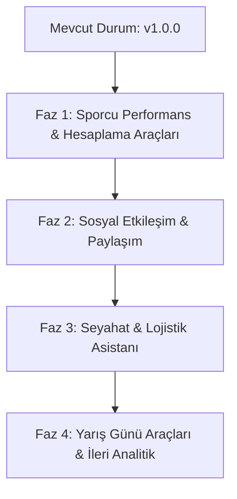

# 🏃 Master Athlete - Gelecek Geliştirme ve Özellik Yol Haritası (Roadmap)

> **Proje:** Master Athlete (Android / Jetpack Compose)  
> **Mevcut Sürüm:** `1.0.0` (`versionCode = 10`)  
> **Odak Kitle:** Master / Veteran Atletler (35+ Yaş Grupları), Antrenörler ve Atletizm Kulüpleri  
> **Tarih:** 31 Ekim 2026  

---

## 📌 Giriş ve Vizyon
Master Athlete, dünyadaki ve Türkiye'deki master atletizm şampiyonalarını otonom AI tarayıcısı ile canlı takip eden, 1975'ten bugüne uzanan 50 yıllık yarışma arşivini barındıran ve sporcuların kariyer derecelerini yönetmesini sağlayan hepsi-bir-arada bir atletizm platformudur.

Bu belge, uygulamanın sonraki sürümlerinde hayata geçirilecek stratejik özellikleri, modül mimarilerini ve kullanıcı deneyimi geliştirmelerini özetler.

---

## 🗺️ Geliştirme Yol Haritası & Fazlar

---

## 🎯 FAZ 1: Sporcu Performans & Hesaplama Araçları

### 1. 🧮 WMA Yaş Faktörü (Age Grading) & Performans Hesaplayıcısı
- **Amaç:** Farklı yaş gruplarındaki (M35, M45, W60 vb.) sporcuların derecelerini dünya standartlarında adil şekilde karşılaştırmak.
- **Teknik Detaylar:**
  - WMA resmi katsayı tablolarının (WMA Age Factors - Koşu, Atlama, Atma) yerel JSON veya Room veri tabanında saklanması.
  - **Age-Graded Performans Yüzdesi:**
    - `%90+` : Dünya Klasmanı (World Class)
    - `%80 - %89.9` : Ulusal Klasman (National Class)
    - `%70 - %79.9` : Bölgesel Klasman (Regional Class)
    - `%60 - %69.9` : Yerel Seviye (Local Class)
  - **Açık Yaş (Open Senior) Dengi:** Sporcunun mevcut derecesinin 20-30 yaş Açık Yaş elit seviyesindeki tahmini karşılığı (Örn: *50 yaşında koşulan 100m 11.90 sn ➔ 25 yaşında koşulan 10.55 sn dengi*).
  - Çoklu branş desteği: Sprint, Orta/Uzun Mesafe, Engelli, Yürüyüş, Atlamalar (Uzun, Üç Adım, Yüksek, Sırık), Atmalar (Gülle, Disk, Cirit, Çekiç, Ağırlık).

### 2. 🎂 Kategori Değişimi & Yaş Günü Projeksiyonu
- Master atletizmde 5'er yıllık yaş kategorileri (35, 40, 45, 50, ...) yeni bir kategoriye girildiğinde sporcuya büyük bir rekabet avantajı sağlar.
- **Geliştirme:**
  - Sporcunun profilinde bir sonraki yaş kategorisine kaç gün/ay kaldığını gösteren geri sayım sayacı.
  - Yeni kategoriye geçildiğinde ilgili kategorinin güncel Türkiye, Balkan ve Avrupa rekorlarını listeleyen motivasyon paneli.

---

## 🎨 FAZ 2: Sosyal Etkileşim & Dijital Sporcu Kimliği

### 3. 🎽 Dijital Sporcu Yarışma Kartı (Social Share Badge)
- **Amaç:** Atletlerin yarışma sonuçlarını, PB (Kişisel En İyi) derecelerini ve madalyalarını sosyal medyada (Instagram Story, WhatsApp vb.) profesyonel bir şablonla paylaşabilmesi.
- **Kart Bileşenleri:**
  - Şampiyona adı, ev sahibi ülke bayrağı, stadyum ve şehir bilgisi.
  - Sporcunun adı, yaş kategorisi (M40, W45 vb.).
  - Branş adı ve koşulan resmi derece.
  - Varsa `PB`, `SB`, `🥇 1.lik (Altın)`, `🥈 2.lik (Gümüş)`, `🥉 3.lük (Bronz)` ve `Rekor (NMR/BMR/EMR/WMR)` rozetleri.
- **Teknik Uygulama:** Compose `rememberGraphicsLayer` veya bitmap render motoru ile cihaz galerisine yüksek çözünürlüklü PNG kaydetme ve Android Share Sheet tetikleme.

---

## ✈️ FAZ 3: Seyahat & Lojistik Asistanı

### 4. 🧭 Yarışma Seyahat & Konaklama Asistanı
- **Amaç:** Yurt içi ve yurt dışı şampiyonalara katılacak atletlerin bilet, transfer ve otel planlamasını tek ekrandan çözmek.
- **Özellikler:**
  - **Uçuş Kısayolu:** Yarışma başlangıç tarihinden 1 gün önce, bitiş tarihinden 1 gün sonra olacak şekilde Google Flights / Skyscanner derin bağlantısı (Deep-link).
  - **Stadyum Çevresi Konaklama:** Yarışmanın yapıldığı stadyumun koordinatlarına göre 3-5 km yarıçapındaki otelleri Google Maps / Booking üzerinde tek tıkla aratma.
  - **Şehir İçi Ulaşım Rehberi:** Şehir merkezinden veya havalimanından stadyuma metro/otobüs güzergah bağlantıları.

### 5. 🌤️ Canlı Hava Durumu & Rüzgar Tahmini (Wind Forecast)
- Atletizmde rüzgar hızı (`+2.0 m/s` üzeri rüzgarlarda rekorlar resmi sayılmaz) ve hava sıcaklığı koşu/atlama performansını doğrudan etkiler.
- **Geliştirme:**
  - Yarışmaya 7-10 gün kala Open-Meteo veya Weather API üzerinden stadyum konumuna özel hava durumu tahmini.
  - Sıcaklık, nem oranı, rüzgar hızı (m/s cinsinden) ve rüzgar yönü gösterimi.

---

## ⏱️ FAZ 4: Yarış Günü Araçları & İleri Analitik

### 6. 🕒 Yarış Günü Çağrı Odası & Isınma Zamanlayıcısı (Call Room Timer)
- Yarışma günlerinde atletlerin en büyük stresi ısınmayı zamanında bitirip **Çağrı Odası'na (Call Room)** vaktinde yetişmektir.
- **Özellikler:**
  - Sporcu yarış saatini girer (Örn: `14:30`).
  - Dinamik geri sayım planı:
    - *Yarışa 90 dk kala:* Genel ısınma ve mobilite
    - *Yarışa 45 dk kala:* Özel koşular ve çivili ayakkabı giyme
    - *Yarışa 25 dk kala:* Çağrı Odası'na giriş (Son kontrol)
  - Bildirim ve sesli uyarı sistemi.

### 7. 📈 Performans İlerleme Grafiği (PB/SB Analytics)
- Sporcunun yıllara göre branş bazlı derece gelişimini gösteren şık çizgi grafikleri.
- Sezon bazlı yarışma yoğunluğu ve kazanılan madalya dağılım grafiği.

---

## 🛠️ Mimari ve Teknik Standartlar

| Modül | Mimari / Kütüphane | Amaç |
| :--- | :--- | :--- |
| **Kullanıcı Arayüzü** | Jetpack Compose + Material 3 | Modern, akıcı ve koyu/açık tema uyumlu arayüz |
| **Durum Yönetimi** | Kotlin Coroutines + StateFlow / Flow | Gerçek zamanlı, reaktif veri akışı |
| **Çevrimdışı Bellek** | SharedPreferences / Room + Offline Firestore | İnternet olmadan da anında tüm arşiv ve profil verilerine erişim |
| **Harita & Konum** | Android Geo Intent + Google Maps URI | Sıfır API maliyetiyle native harita ve yol tarifi |
| **Otonom Tarayıcı** | Python + Gemini Lite & Multi-Method Scraper | Gelecek yarışmaları GitHub Actions üzerinden sıfır maliyetle canlı güncelleme |
