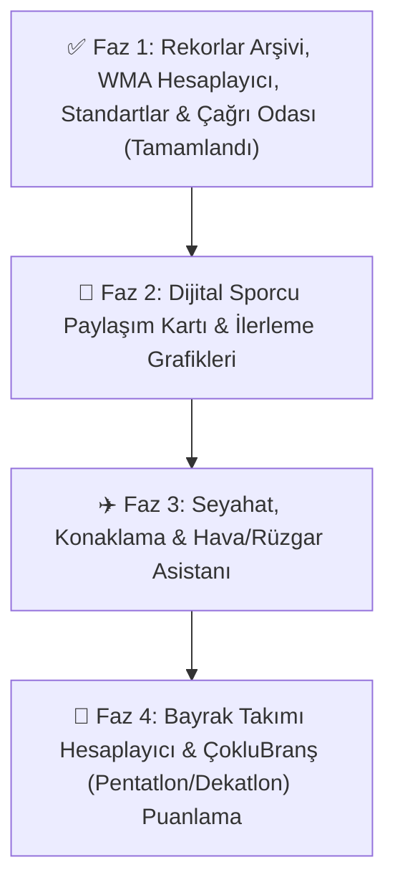

# 🏃 Master Athlete - Uygulamadaki Son Durum ve Geliştirme Yol Haritası (Roadmap)

> **Proje:** Master Athlete (Android / Jetpack Compose)  
> **Mevcut Sürüm:** `1.0.0` (`versionCode = 10`)  
> **Odak Kitle:** Master / Veteran Atletler (35+ Yaş Grupları), Antrenörler ve Atletizm Kulüpleri  
> **Son Güncelleme:** 4 Kasım 2026  

---

## ✅ Uygulamadaki Son Durum (Halihazırda Mevcut Özellikler)

Uygulamada şu ana kadar tamamlanarak aktif kullanıma sunulan tüm modüller ve özellikler aşağıda maddeler halinde özetlenmiştir:

1. **5 Sekmeli Modern Alt Gezinme Çubuğu (`Bottom Navigation Bar`) & Marka Kimliği:**
   - Ekranın altında yer alan **`📅 Takvim` | `🏆 Rekorlar` | `📏 Standartlar` | `⏱️ Çağrı Odası` | `👤 Profil`** alt menüsü ile tüm ana modüllere tek dokunuşla erişim.
   - Üst barda orijinal **Master Athlete** logosu, kurumsal başlık ve **Ayarlar (`⚙️`)** menüsü.
2. **Küresel Yarışma Takvimi & 50 Yıllık Arşiv (1975–2027+):**
   - Otonom AI tarama motoru ve çoklu kaynak toplayıcısı ile güncellenen Ulusal, Balkan, Avrupa ve Dünya master atletizm şampiyonaları.
   - Her yarışma kartında ülke bayrağı, yarışma kapsamı, kalan gün sayacı (`CountdownBadge`), tarih ve şehir bilgisi.
3. **Gelişmiş Arama, Tarih ve Çoklu Filtreleme:**
   - Şehir veya şampiyona adına göre anlık arama.
   - Hızlı tarih filtreleri (`Tümü`, `Gelecek 3 Ay`, `Bu Yıl`, `Gelecek Yıl`, `Geçmiş Arşiv`) ve tamamlanan yarışmaları gizleme seçeneği.
   - Kapsam (`Ulusal`, `Balkan`, `Avrupa`, `Dünya`) ve ülke bazlı detaylı alt pencere filtrelemesi.
4. **Yarışma Detayları, Harita & Cihaz Takvimi Entegrasyonu:**
   - Stadyum ve şehir konumunu tek tıkla **Google Haritalar** üzerinde açma.
   - Şampiyonayı tek dokunuşla telefonun **Cihaz Takvimine** kaydetme ve resmi organizasyon web sitesine yönlendirme.
5. **Kapsamlı Resmi Master Rekorları Arşivi (`🏆 Rekorlar` Sekmesi):**
   - **Açık Saha (Outdoor)** ve **Salon (Indoor)** ayrımıyla tüm yaş kategorileri (`M35–M100`, `W35–W100`) ve **Karma (`MIX`) Bayrak** kategorileri.
   - **Türkiye Rekorları (NMR - TAF)**, **Balkan Şampiyona Rekorları (BŞR - BAMA)**, **Balkan Rekorları (BMR - BAMA)**, **Avrupa Rekorları (EMR - EMA)** ve **Dünya Rekorları (WMR - WMA)** dahil **3.000+ resmi rekor**.
   - Seçilen yaş kategorisi ve cinsiyete göre **dinamik branş filtreleme** (Örn: M35 için 110m Engelli, W35 için 100m Engelli, W40+/M70+ için 80m Engelli) ve Maraton / Yarı Maraton hassas ayrımı.
   - Ortak rekor (`🤝 Ortak Rekor`), el kronometresi (`⏱️ El Zamanı Tescili`) gösterimi ve sporcunun kendi kişisel en iyi derecesiyle (`Senin En İyi Derecen (PB)` + yaptığı yaş kategorisi) canlı karşılaştırma kartı.
6. **WMA Branş Standartları Rehberi (`📏 Standartlar` Sekmesi):**
   - Yaş ve cinsiyet gruplarına (`M35–M100`, `W35–W100`) göre resmi **Kısa Engelli (`110m / 100m / 80m` & Salon `60m`)**, **Uzun Engelli (`400m / 300m / 200m`)** ve **Su Engelli (`3000m / 2000m`)** engel yükseklikleri, engel sayıları, 1. engele mesafe, engeller arası mesafe ve son engelden finişe mesafe ölçüleri.
   - Yaş ve cinsiyete göre resmi **Gülle**, **Disk**, **Cirit**, **Çekiç** ve **Ağırlık Atma (Weight Throw)** ekipman ağırlıkları tablosu ve sporcunun kendi kategorisini (`Senin Kategorin`) otomatik vurgulama özelliği.
7. **Yarış Günü & Çağrı Odası Isınma Zamanlayıcısı (`⏱️ Çağrı Odası` Sekmesi):**
   - Branş grubuna göre (**Sprint & Engelli**, **Orta & Uzun Mesafe**, **Atlama & Atma**) özelleştirilmiş adım adım ısınma, dril, çivili giyme ve **Çağrı Odası (Call Room)** zaman çizelgesi; aktif aşamayı **`ŞU AN`** etiketiyle canlı vurgulama.
   - Saniye bazlı canlı **Çağrı Odasına Kalan Süre** ve **Starta Kalan Süre** geri sayımı, özelleştirilebilir çağrı odası kapanış süresi (`-15 dk`, `-20 dk`, `-30 dk`, `-40 dk`) ve tıklanabilir **Çağrı Odası Son Kontrol Listesi (Checklist)**.
8. **Sporcu Profili, WMA Yaş Faktörü Hesaplayıcısı & Kariyer Dereceleri (`👤 Profil` Sekmesi):**
   - Profilin en üstünde doğrudan erişilen **WMA Yaş Faktörü (Age Grading) & Performans Hesaplayıcısı** (derecenin 20-30 yaş Açık Yaş Elit dengini ve dünya klasman yüzdesini hesaplama + tek tıkla profile kaydetme).
   - **Takibimdekiler** ve **Derecelerim** olmak üzere iki sekmeli sadeleştirilmiş yapı; tarihi geçen takip edilen yarışlara doğrudan **+ Derece Ekle** akışı.
   - **Koşu**, **Atlama** ve **Atma** branşlarına özel tasarlanmış ikonlarla gruplanan ferah derece kartları (`PB`, `SB`, `🥇/🥈/🥉 Madalya`, `NMR/BMR/EMR/WMR Rekor` ve `% WMA` rozetleri).
   - Branş tipine göre akıllı derece girişi (Sprint `Saniye.Salise`, Orta/Uzun mesafe `Dakika:Saniye.Salise`, Maraton `Saat:Dakika:Saniye`, Saha branşları `Metre.Santimetre`).
9. **Koyu / Açık Tema & Çevrimdışı (Offline-First) Mimari:**
   - İnternet bağlantısı olmasa bile tüm yarışma takvimine, 3.000+ rekor arşivine, WMA standartlarına, çağrı odası sayacına ve kişisel derecelere anında erişim.
   - Sistem varsayılanı, Açık Tema ve Koyu Tema seçenekleri.

---

## 🗺️ Geliştirme Yol Haritası & Fazlar

---

## ✅ TAMAMLANAN FAZLAR (FAZ 1)

- [x] **1. WMA Yaş Faktörü (Age Grading) & Performans Hesaplayıcısı** *(Tamamlandı)*
- [x] **2. Resmi Master Rekorları Arşivi (NMR, BŞR, BMR, EMR, WMR - Açık Saha & Salon)** *(Tamamlandı)*
- [x] **3. Yaş ve Cinsiyete Göre Dinamik Branş Filtreleme & Maraton/Yarı Maraton Ayrımı** *(Tamamlandı)*
- [x] **4. WMA Branş Standartları Rehberi (Engel Yükseklikleri & Atma Ağırlıkları Tablosu)** *(Tamamlandı)*
- [x] **5. Yarış Günü & Çağrı Odası (Call Room) Isınma Zamanlayıcısı ve Kontrol Listesi** *(Tamamlandı)*
- [x] **6. 5 Sekmeli Alt Gezinme Çubuğu (Bottom Navigation Bar) & Yenilenen Profil Deneyimi** *(Tamamlandı)*

---

## 🎯 FAZ 2: Sosyal Paylaşım & Performans Analitiği *(SIRADAKİ FAZ)*

### 1. 🎽 Dijital Sporcu Yarışma Kartı (Social Share Badge)
- **Amaç:** Atletlerin yarışma sonuçlarını, PB (Kişisel En İyi) derecelerini ve madalyalarını sosyal medyada (Instagram Story, WhatsApp vb.) profesyonel bir şablonla paylaşabilmesi.
- **Kart Bileşenleri:**
  - Şampiyona adı, ev sahibi ülke bayrağı, stadyum ve şehir bilgisi.
  - Sporcunun adı, yaş kategorisi (`M35`, `W40` vb.), branş adı ve resmi derecesi.
  - Varsa `PB`, `SB`, `🥇/🥈/🥉 Madalya`, `WMA %` ve `Rekor (NMR/BMR/EMR/WMR)` rozetleri.
- **Teknik Uygulama:** Derecelerim kartlarındaki paylaş (`Share`) ikonuyla yüksek çözünürlüklü PNG kart üretimi ve Android Share Sheet tetikleme.

### 2. 📈 Performans İlerleme Grafiği (PB/SB & WMA % Analytics)
- Sporcunun yıllara göre branş bazlı derece gelişimini ve WMA yaş yüzdesi eğrisini gösteren görsel çizgi grafikleri.
- Sezon bazlı kazanılan madalya ve kırılan kişisel rekor özeti.

---

## ✈️ FAZ 3: Seyahat, Lojistik & Hava Durumu Asistanı

### 3. 🧭 Yarışma Seyahat & Konaklama Asistanı
- **Amaç:** Yurt içi ve yurt dışı şampiyonalara katılacak atletlerin bilet, transfer ve otel planlamasını yarışma detay ekranından tek tıkla çözmek.
- **Özellikler:**
  - **Uçuş Kısayolu:** Yarışma başlangıç tarihinden 1 gün önce, bitiş tarihinden 1 gün sonra olacak şekilde Google Flights / Skyscanner derin bağlantısı (Deep-link).
  - **Stadyum Çevresi Konaklama:** Yarışmanın yapıldığı stadyumun koordinatlarına göre yakın otelleri Google Maps / Booking üzerinde tek tıkla aratma.

### 4. 🌤️ Canlı Hava Durumu & Rüzgar Tahmini (Wind Forecast)
- Atletizmde rüzgar hızı (`+2.0 m/s` üzeri rüzgarlarda sprint ve uzun/üçadım atlama rekorları resmi sayılmaz) ve hava sıcaklığı performansı doğrudan etkiler.
- **Özellikler:**
  - Yalnızca gelecek yarışmalarda gösterilir; stadyum koordinatlarına göre Open-Meteo API üzerinden sıcaklık, nem ve rüzgar hızı/yönü tahmini sunar.

---

## 🤝 FAZ 4: İleri Master Atletizm Hesaplayıcıları *(Yeni Fikirler)*

### 5. 🏃‍♂️🏃‍♀️ Bayrak Takımı (4x100m / 4x400m / MIX) Yaş Kategorisi Hesaplayıcı
- **Amaç:** Master şampiyonalarda 4 sporcunun doğum yıllarına/yaşlarına göre takımın hangi yaş grubunda (`M35`, `M45`, `MIX 40` vb. - en genç sporcunun yaş grubu kuralı veya BAMA/WMA kuralları) yarışacağını ve o kategorinin rekorunu tek ekranda göstermek.

### 6. 🏅 Çoklu Branş (Pentatlon / Atma Pentatlonu / Dekatlon) Puan Hesaplayıcı
- **Amaç:** Master atletizmde yaş faktörlü IAAF/WMA kombine branş puan tablolarını kullanarak her branştaki dereceden toplam Pentatlon / Atma Pentatlonu puanını otomatik hesaplamak.

---

## 🛠️ Mimari ve Teknik Standartlar

| Modül | Mimari / Kütüphane | Amaç |
| :--- | :--- | :--- |
| **Kullanıcı Arayüzü** | Jetpack Compose + Material 3 | Modern, akıcı, 5 sekmeli alt bar ve koyu/açık tema uyumlu arayüz |
| **Durum Yönetimi** | Kotlin Coroutines + StateFlow / Flow | Gerçek zamanlı, reaktif veri akışı |
| **Çevrimdışı Bellek** | SharedPreferences + Yerel Arşiv | İnternet olmadan da anında tüm takvim, 3.000+ rekor, standartlar ve profil verilerine erişim |
| **Harita & Konum** | Android Geo Intent + Google Maps URI | Sıfır API maliyetiyle native harita ve yol tarifi |
| **Otonom Tarayıcı** | Python + Gemini Lite & Multi-Method Scraper | Gelecek yarışmaları GitHub Actions üzerinden sıfır maliyetle canlı güncelleme |
