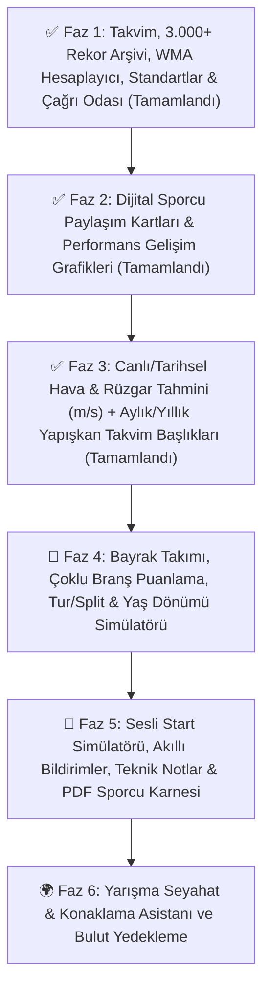

# 🏃 Master Athlete — Proje Arşivi & Yeni Geliştirme Yol Haritası (Roadmap)

> **Proje:** Master Athlete (Android / Jetpack Compose)  
> **Mevcut Sürüm:** `1.0.0` (`versionCode = 12`)  
> **Odak Kitle:** Master / Veteran Atletler (35+ Yaş Grupları), Antrenörler ve Atletizm Kulüpleri  
> **Son Güncelleme:** 6 Kasım 2026  

---

## 🏛️ BÖLÜM 1: TAMAMLANAN ÖZELLİKLER ARŞİVİ (Sürüm `1.0.0` — `versionCode = 12` İtibarıyla)

Bu bölüm, projenin başlangıcından bugüne kadar geliştirilip canlıya alınan tüm modüllerin, mimari kararların ve fazların kalıcı arşividir.

### 📌 Genel Mimari & Faz Özeti

---

### ✅ FAZ 1: Çekirdek Platform, Küresel Takvim, Rekorlar, Standartlar & Çağrı Odası *(TAMAMLANDI)*

1. **5 Sekmeli Modern Alt Gezinme Çubuğu (`Bottom Navigation Bar`) & Marka Kimliği:**
   - Ekranın altında yer alan **`📅 Takvim` | `🏆 Rekorlar` | `📏 Standartlar` | `⏱️ Çağrı Odası` | `👤 Profil`** alt menüsü ile tüm ana modüllere tek dokunuşla erişim.
   - Üst barda orijinal **Master Athlete** logosu, kurumsal başlık ve **Ayarlar (`⚙️`)** menüsü.
2. **Küresel Yarışma Takvimi & 50 Yıllık Arşiv (1975–2028+):**
   - Otonom AI tarama motoru ve çoklu kaynak toplayıcısı ile güncellenen Ulusal, Balkan, Avrupa ve Dünya master atletizm şampiyonaları.
   - Her yarışma kartında ülke bayrağı, yarışma kapsamı, kalan gün sayacı (`CountdownBadge`), tarih ve şehir bilgisi.
   - Ulusal ve uluslararası şampiyona isimlerini (Birleşik Krallık BMAF 5K/10K Yol, Kros, Atmalar, Çoklu Branşlar, Fransa, Almanya, İtalya, İspanya, Balkan, Avrupa ve Dünya şampiyonaları dahil) branşına göre temiz ve hatasız Türkçeleştiren akıllı başlık motoru (`getDisplayTitle`).
3. **Gelişmiş Arama, Tarih ve Çoklu Filtreleme:**
   - Şehir veya şampiyona adına göre anlık arama.
   - Hızlı tarih filtreleri (`Tümü`, `Gelecek 3 Ay`, `Bu Yıl`, `Gelecek Yıl`, `Geçmiş Arşiv`) ve tamamlanan yarışmaları gizleme seçeneği.
   - Kapsam (`Ulusal`, `Balkan`, `Avrupa`, `Dünya`) ve ülke bazlı detaylı alt pencere filtrelemesi.
4. **Yarışma Detayları, Harita & Cihaz Takvimi Entegrasyonu:**
   - Stadyum ve şehir konumunu tek tıkla **Google Haritalar** üzerinde açma.
   - Şampiyonayı tek dokunuşla telefonun **Cihaz Takvimine** kaydetme ve resmi organizasyon web sitesine yönlendirme.
5. **Kapsamlı Resmi Master Rekorları Arşivi (`🏆 Rekorlar` Sekmesi):**
   - **Açık Saha (Outdoor)** ve **Salon (Indoor)** ayrımıyla tüm yaş kategorileri (`M35–M100`, `W35–W100`) ve **Karma (`MIX`) Bayrak** kategorileri.
   - **Türkiye Rekorları (NMR - TAF)**, **Balkan Şampiyona Rekorları (BŞR - BAMA)**, **Balkan Rekorları (BMR - BAMA)**, **Avrupa Rekorları (EMR - EMA)** ve **Dünya Rekorları (WMR - WMA)** dahil **3.000+ resmi rekor**.
   - Seçilen yaş kategorisi ve cinsiyete göre **dinamik branş filtreleme** (Örn: M35 için 110m Engelli, W35 için 100m Engelli, W40+/M70+ için 80m Engelli) ve Maraton / Yarı Maraton hassas ayrımı.
   - Ortak rekor (`🤝 Ortak Rekor`), el kronometresi (`⏱️ El Zamanı Tescili`) gösterimi ve sporcunun kendi kişisel en iyi derecesiyle (`Senin En İyi Derecen (PB)` + yaptığı yaş kategorisi) canlı karşılaştırma kartı.
6. **WMA Branş Standartları Rehberi (`📏 Standartlar` Sekmesi):**
   - Yaş ve cinsiyet gruplarına (`M35–M100`, `W35–W100`) göre resmi **Kısa Engelli (`110m / 100m / 80m` & Salon `60m`)**, **Uzun Engelli (`400m / 300m / 200m`)** ve **Su Engelli (`3000m / 2000m`)** engel yükseklikleri, engel sayıları, 1. engele mesafe, engeller arası mesafe ve son engelden finişe mesafe ölçüleri.
   - Yaş ve cinsiyete göre resmi **Gülle**, **Disk**, **Cirit**, **Çekiç** ve **Ağırlık Atma (Weight Throw)** ekipman ağırlıkları tablosu ve sporcunun kendi kategorisini (`Senin Kategorin`) otomatik vurgulama özelliği.
7. **Yarış Günü & Çağrı Odası Isınma Zamanlayıcısı (`⏱️ Çağrı Odası` Sekmesi):**
   - Branş grubuna göre (**Sprint & Engelli**, **Orta & Uzun Mesafe**, **Atlama & Atma**) özelleştirilmiş adım adım ısınma, dril, çivili giyme ve **Çağrı Odası (Call Room)** zaman çizelgesi; aktif aşamayı **`ŞU AN`** etiketiyle canlı vurgulama.
   - Saniye bazlı canlı **Çağrı Odasına Kalan Süre** ve **Starta Kalan Süre** geri sayımı, özelleştirilebilir çağrı odası kapanış süresi (`-15 dk`, `-20 dk`, `-30 dk`, `-40 dk`) ve tıklanabilir **Çağrı Odası Son Kontrol Listesi (Checklist)**.
8. **Sporcu Profili, WMA Yaş Faktörü Hesaplayıcısı & Kariyer Dereceleri (`👤 Profil` Sekmesi):**
   - Profilin en üstünde doğrudan erişilen **WMA Yaş Faktörü (Age Grading) & Performans Hesaplayıcısı** (derecenin 20-30 yaş Açık Yaş Elit dengini ve dünya klasman yüzdesini hesaplama + tek tıkla profile kaydetme).
   - Tarihi geçen takip edilen yarışlara doğrudan **+ Derece Ekle** akışı.
   - **Koşu**, **Atlama** ve **Atma** branşlarına özel tasarlanmış ikonlarla gruplanan ferah derece kartları (`PB`, `SB`, `🥇/🥈/🥉 Madalya`, `NMR/BMR/EMR/WMR Rekor` ve `% WMA` rozetleri).
   - Branş tipine göre akıllı derece girişi (Sprint `Saniye.Salise`, Orta/Uzun mesafe `Dakika:Saniye.Salise`, Maraton `Saat:Dakika:Saniye`, Saha branşları `Metre.Santimetre`).
9. **Koyu / Açık Tema & Çevrimdışı (Offline-First) Mimari:**
   - İnternet bağlantısı olmasa bile tüm yarışma takvimine, 3.000+ rekor arşivine, WMA standartlarına, çağrı odası sayacına ve kişisel derecelere anında erişim.
   - Sistem varsayılanı, Açık Tema ve Koyu Tema seçenekleri.

---

### ✅ FAZ 2: Dijital Sporcu Paylaşım Kartları & Performans Analitiği *(TAMAMLANDI)*

10. **Dijital Sporcu Yarışma & Kariyer Paylaşım Kartları (`Social Share Badge`):**
    - **Tekil Derece / Yarış Sonucu Kartı:** `Derecelerim` sekmesindeki her derecenin yanındaki Paylaş (`Share`) ikonuyla açılan, her temaya özel transparan stadyum/pist/podyum arka planlarına sahip (**`🌌 Elit Lacivert`**, **`🔥 Kırmızı Pist`**, **`🏆 Altın Podyum`**) canlı önizlemeli ve **1080p yüksek çözünürlüklü PNG** yarışma sonuç kartı.
    - **Kariyer & PB Özeti Kartı:** Profilin en üstündeki sporcu kimlik kartında yer alan Paylaş (`Share`) ikonuyla açılan; sporcunun tüm branşlardaki kişisel en iyi derecelerini (`PB`), toplam madalya sayısını ve en yüksek `WMA %` skorunu tek bir görsel kartta birleştiren paylaşım modülü.
11. **Performans İlerleme Grafiği & Kariyer Analitiği (`📈 Gelişimim` Sekmesi):**
    - `Profilim` ekranında 3. sekme olarak yer alan (`Takibimdekiler | Derecelerim | 📈 Gelişimim`) ve `Derecelerim` içindeki her branş kartının sağ üstündeki **`📈 Gelişim`** butonuyla da doğrudan açılabilen analiz paneli.
    - **Kariyer & Madalya Özeti:** Kazanılan altın (`🥇`), gümüş (`🥈`), bronz (`🥉`) madalya dağılımı, resmi rekor sayısı, en iyi ve ortalama `WMA %` skoru.
    - **Çift Modlu İnteraktif Çizgi & Alan Grafiği:** Branş bazlı **`⏱️ Derece Gelişimi (sn/m)`** ve **`📊 WMA Yaş Yüzdesi (%)`** eğrisi (`PB` noktası özel rozetli) ve yarışlar arası fark (`▲ Gelişim / Δ`) kronolojisi.

---

### ✅ FAZ 3: Hava & Rüzgar Tahmini (`m/s`) ve Takvim Deneyimi İyileştirmeleri *(TAMAMLANDI)*

12. **Yarışma Zamanı Hava & Rüzgar Tahmini (`DetailBottomSheet`):**
    - Yarışma kartı açıldığında **yarışmanın yapılacağı tarihteki gündüz (yarışma saati)** hava sıcaklığını ve maksimum rüzgar hızını (`m/s`) gösterir (`Yarışma Zamanı Hava & Rüzgar Tahmini: Hava sıcaklığı XX°C (...) • 💨 Rüzgar X.X m/s`).
    - Yarışmaya **≤ 16 gün** kala **Open-Meteo Canlı Tahmin** verisini, **> 16 gün** uzaktaki yarışmalarda ise o şehrin tam yarışma gününe (`Ay-Gün`) ait **Open-Meteo Tarihsel İklim Arşivi** verisini kullanarak her bakışta güncel tahmin sunar.
13. **Çağrı Odası Anlık Konum (`Konumum`) Hava, Rüzgar Yönü & Rekor Geçerlilik Kontrolü (`CallRoomScreen`):**
    - Şehir seçme menüsüne ihtiyaç duymadan kullanıcının o an bulunduğu konumu (**`Konumum`**) otomatik algılar.
    - Anlık sıcaklığı (`°C`), günün en yüksek / gecenin en düşük sıcaklığını (`↑ / ↓`), anlık rüzgar hızını (`m/s`), rüzgar yönünü ve sprint/atlama branşları için kritik olan **`+2.0 m/s` WMA Rekor Geçerlilik Sınırı** rozetini (`🟢 ≤ +2.0 m/s • Rekor Geçerli Rüzgar` / `⚠️ > +2.0 m/s • Rekor Sınırı Üstü Rüzgar`) canlı olarak gösterir.
14. **Takvimde Yapışkan Yıl & Ay Kesmeleri (`Sticky Month/Year Headers`):**
    - Yarışma listesini kaydırırken ekranın üstünde sabit kalarak geçiş yapan **`[2026] KASIM`**, **`[2027] OCAK`** gibi yıl/ay başlıkları ve o aydaki toplam yarışma sayısı rozeti (`3 yarışma`).

---

## 🚀 BÖLÜM 2: YENİ GELİŞTİRME YOL HARİTASI (GELECEK FAZLAR)

Aşağıdaki fazlar, uygulamayı bir takvim ve rekor arşivinden **her master atletin antrenmanda, çağrı odasında ve şampiyona planlamasında elinden düşüremeyeceği eksiksiz bir dijital koça** dönüştürmek için tasarlanmıştır:

---

### 🎯 FAZ 4: İleri Master Atletizm Hesaplayıcıları & Yarışma Strateji Araçları *(SIRADAKİ FAZ)*

#### 1. 🏃‍♂️🏃‍♀️ Bayrak Takımı (`4x100m / 4x400m / MIX`) Yaş Kategorisi & Süre Hesaplayıcı
- **Amaç:** Master şampiyonalarda bayrak takımı kurarken yaşanan *"Hangi yaş grubunda yarışacağız ve rekor kaç?"* sorusunu saniyeler içinde çözmek.
- **Özellikler:**
  - 4 sporcunun doğum tarihlerini (veya yaşlarını) girerek WMA/EMA/BAMA kuralına göre (en genç sporcunun yaş grubu kuralı) takımın resmi yarışma kategorisini (`M35`, `M45`, `W40`, `MIX 45` vb.) otomatik belirleme.
  - Belirlenen kategorinin **Türkiye (NMR), Balkan (BMR), Avrupa (EMR) ve Dünya (WMR)** rekorlarını tek ekranda listeleme.
  - 4 sporcunun bireysel `100m` veya `400m` derecelerini girerek bayrak değişim kazanç payıyla birlikte **tahmini takım bitiş derecesini** hesaplama.

#### 2. 🏅 Çoklu Branş (`Pentatlon / Atma Pentatlonu / Dekatlon / Heptatlon`) WMA Puan Hesaplayıcı
- **Amaç:** Kombine branşlarda yarışan master atletlerin yaş faktörlü resmi WMA puanlarını ve son branş öncesi hedef derecelerini hesaplamak.
- **Özellikler:**
  - Açık Saha **Pentatlon**, Salon **Pentatlon**, **Atma Pentatlonu (Throws Pentathlon)**, **Dekatlon** ve **Heptatlon** desteği.
  - Her branşın derecesi girildikçe önce **WMA Yaş Faktörü** ile dönüştürülmüş dereceyi, ardından **IAAF/WMA Kombine Puan Tablosu** karşılığını ve genel toplam puanı canlı gösterme.
  - **"Hedef Puan / Rekor İçin Son Branşta Kaç Lazım?" Modu:** Örneğin 4 branş sonunda toplam hedef puana veya Türkiye rekoruna ulaşmak için son branş olan `1500m`/`800m` veya `Cirit`'te yapılması gereken tam dereceyi hesaplama.

#### 3. ⏱️ Pist Tur & Geçiş Süresi (`Split / Pace`) Strateji Hesaplayıcı (`400m – Maraton`)
- **Amaç:** `400m`, `800m`, `1500m`, `3000m`, `5000m`, `10.000m` ve yol koşularında hedef dereceye ulaşmak için her `200m` / `400m` turunda veya her kilometrede kronometrede kaç görülmesi gerektiğini çıkarmak.
- **Özellikler:**
  - Hedef bitiş süresini girince otomatik **`200m`**, **`400m` (Tur)**, **`800m`** ve **`1000m`** geçiş tablosu oluşturma.
  - **Yarış Stratejisi Seçimi:** Eşit Tempo (`Even Split`), İkinci Yarı Hızlanan (`Negative Split`) veya Hızlı Başlangıç (`Positive Split`) dağılımları.
  - İstenen hedef sürenin sporcunun yaş grubunda kaç **`% WMA`** puanına denk geldiğini anında gösterme.

#### 4. 🎂 "Yeni Yaş Kategorisi" (Yaş Dönümü) Avantaj Simülatörü
- **Amaç:** Master atletizmin en büyük motivasyon kaynağı olan **5 yılda bir üst yaş grubuna geçişi** (`M35 → M40`, `M45 → M50`, `W40 → W45` vb.) görselleştirmek.
- **Özellikler:**
  - Sporcunun doğum tarihine göre bir sonraki yaş grubuna geçmesine **kaç gün kaldığını** gösterme.
  - *"Bugünkü PB derecemi yeni yaş grubumda yaparsam WMA yüzdem kaça çıkar ve Türkiye/Balkan/Avrupa rekoruna ne kadar yaklaşırım?"* simülasyonu.
  - Yeni yaş grubunda değişecek olan **engel yüksekliği, engel aralığı veya atma ekipmanı ağırlığı** avantajlarını tek kartta özetleme.

---

### 🚀 FAZ 5: Antrenman, Saha Yardımcıları & Akıllı Bildirimler

#### 5. 🔫 Sesli "Yarış Komutu" Start Simülatörü (`On Your Marks / Set / Bang!`)
- **Amaç:** Sprint ve engelli koşucularının tek başına antrenman yaparken gerçek hakem komutuyla çıkış (reaksiyon) çalışabilmesini sağlamak.
- **Özellikler:**
  - `⏱️ Çağrı Odası` sekmesi içinde yer alan **"Start Antrenmanı"** modu.
  - Türkçe (*"Yerlerinize" — "Hazır" — 🔫 Çıkış Sesi*) ve Uluslararası İngilizce (*"On your marks" — "Set" — 🔫 Bang*) sesli komut seçenekleri.
  - Gerçek yarışlardaki gibi ezberlemeyi önleyen **rastgele `1.4 sn – 2.3 sn` arası `Hazır (Set)` bekleme süresi** ve opsiyonel telefon flaşı/titreşim tetiklemesi.

#### 6. 🔔 Akıllı Şampiyona & Son Kayıt Tarihi (`Entry Deadline`) Bildirimleri
- **Amaç:** Sporcunun `Takibimdekiler` listesine eklediği şampiyonaların kayıt ve hazırlık dönemlerini kaçırmamasını sağlamak.
- **Özellikler:**
  - Takip edilen yarışmaya **90 gün** (genel kayıt açılışı), **30 gün** (son kayıt haftası uyarısı), **7 gün** (yarış haftası) ve **1 gün** kala otomatik yerel bildirim (`WorkManager`).
  - Sporcunun doğum gününde ve yeni bir 5 yıllık yaş kategorisine (`40, 45, 50, 55...`) girdiği gün özel kutlama ve yeni kategori rekor özeti bildirimi.

#### 7. 📓 Teknik Antrenman Notları & Çivili / Ekipman Takibi
- **Amaç:** Derecelerin yanına yarışma veya antrenman teknik detaylarını kaydedebilmek.
- **Özellikler:**
  - Her derece kaydına opsiyonel **Rüzgar (`+1.4 m/s`)**, **Çıkış Bloğu Ayarı**, **1. Engele Adım Sayısı**, **Atma Yaklaşma Adımı** veya **Kullanılan Çivili Ayakkabı** notu ekleyebilme.
  - Hangi çivili ayakkabıyla veya hangi stadyumda en iyi derecelerin çıktığını görme.

#### 8. 📄 Resmi "Dijital Sporcu Karnesi & Özgeçmişi (Athlete CV)" PDF Çıktısı
- **Amaç:** Kulüp transferlerinde, sponsor dosyalarında, vize başvurularında veya milli takım/federasyon bildirimlerinde kullanılmak üzere tek tıkla resmi görünümlü **1 sayfalık PDF Sporcu Özgeçmişi** üretmek.
- **Özellikler:**
  - Sporcunun kimlik bilgileri, yaş kategorisi, en iyi dereceleri (`PB`), `WMA %` dünya klasman yüzdesi, kazandığı madalyalar ve katıldığı şampiyonaların kronolojik tablosunu içeren kurumsal PDF belgesi.

---

### 🌍 FAZ 6: Seyahat Lojistiği, Kulüp & Topluluk Özellikleri

#### 9. 🧭 Yarışma Seyahat & Konaklama Asistanı
- **Amaç:** Yurt içi ve yurt dışı şampiyonalara katılacak atletlerin bilet, transfer ve otel planlamasını yarışma detay ekranından tek tıkla çözmek.
- **Özellikler:**
  - **Hafızalı Kalkış Şehri Seçicisi (`🛫 Kalkış Şehrim`):** Sporcunun kendi şehrini/havalimanını bir kez seçip kaydetmesi; yarışma kendi şehrindeyse doğrudan stadyum yol tarifine geçmesi.
  - **Uçuş Kısayolu:** Yarışma başlangıç tarihinden 1 gün önce, bitiş tarihinden 1 gün sonra olacak şekilde Google Flights / Skyscanner derin bağlantısı.
  - **Stadyum Çevresi Konaklama:** Yarışmanın yapıldığı stadyumun konumuna göre yakın otelleri Google Maps / Booking üzerinde tek tıkla aratma.

#### 10. ☁️ Yedekleme / Geri Yükleme (`JSON / Dosya Aktarımı`) & Çoklu Cihaz Desteği
- **Amaç:** Sporcunun telefon değiştirdiğinde tüm profil bilgilerini, takip ettiği yarışmaları ve kariyer derecelerini tek dosyayla yeni telefonuna aktarabilmesi.
- **Özellikler:**
  - `Ayarlar` menüsünden **"Verilerimi Dışa Aktar (Yedekle)"** ve **"Yedekten Geri Yükle"** seçenekleri ile sıfır veri kaybı garantisi.

---

## 🛠️ Mimari ve Teknik Standartlar

| Modül | Mimari / Kütüphane | Amaç |
| :--- | :--- | :--- |
| **Kullanıcı Arayüzü** | Jetpack Compose + Material 3 | Modern, akıcı, 5 sekmeli alt bar, yapışkan yıl/ay başlıkları ve koyu/açık tema uyumlu arayüz |
| **Durum Yönetimi** | Kotlin Coroutines + StateFlow / Flow | Gerçek zamanlı, reaktif veri akışı |
| **Çevrimdışı Bellek** | SharedPreferences + Yerel JSON Arşivi | İnternet olmadan da anında tüm takvim, 3.000+ rekor, standartlar ve profil verilerine erişim |
| **Hava & Rüzgar Motoru** | Open-Meteo Forecast + Historical Archive API | Sıfır API anahtarı maliyetiyle yarışma günü (`m/s`) rüzgar/sıcaklık tahmini ve anlık konum (`Konumum`) ölçümü |
| **Harita & Konum** | Android Geo Intent + Fused/LocationManager | Sıfır API maliyetiyle native harita, yol tarifi ve Çağrı Odası canlı stadyum konumu |
| **Otonom Tarayıcı** | Python + Gemini Lite & Multi-Method Scraper | Gelecek yarışmaları GitHub Actions üzerinden sıfır maliyetle canlı güncelleme |
